# StarLevelSystem

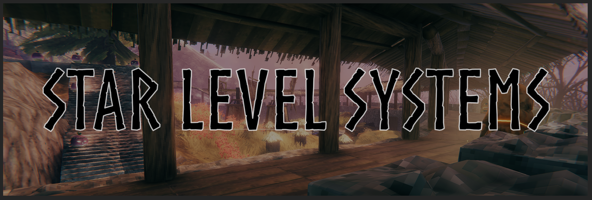

Star Level Systems expands upon the Valheim star system and allows extensive customization.

Features:
- Expand Creature Star levels (as high as you want)
	- Sizing configuration for all creatures
- Customize Raids, complete control over creatures, activation mechanics etc
    - Raids will be tailed to each players progress and multiple raids can occur at the same time
- Multiple different scaling strategies
    - Scale levels by distance
    - Scale levels by zones
    - Scale levels by regions, cut from the land along its shorelines
    - Scale levels by bosses killed
- Nemesis System (personal/group dungeon master)
    - Can modify the world around you to make things easier, harder or provide unique challenges/opportunities
- Fine grained control of all creature aspects
	- Health, damage, size, speed, attack speed, base and per level
	- Resistance or weakness to all elements
- Unique colorization for any creature
	- Per level colorization for any creature
	- Bulk color generators for defining whole ranges of color levels
- Unique Modifiers for all creatures, multiple different categories (Boss, Major, Minor)
	- Creatures names based on modifiers
	- Star Icons based on modifiers
	- Visual effects for modifiers
	- Per level, fine grained configuration and tuning of modifiers
- Scaling, fine-grained control and configuration of all creature drops
	- scale individual loot entries differently
	- modify chance drops based on level of the creature
	- Add, remove, change all drops
- Scaling of the world around you
	- level up the FISH!
	- level scaled BIRDS
	- level scaled TREES
- Configurable location, dungeon, terrain and ore resets to passively regenerate the world around you
    - Supports mod locations, resources, and pickables

Got a bug to report or just want to chat about the mod? Drop by the discord or github.

 

Below are a few examples of what you might see, and what the mod can do.

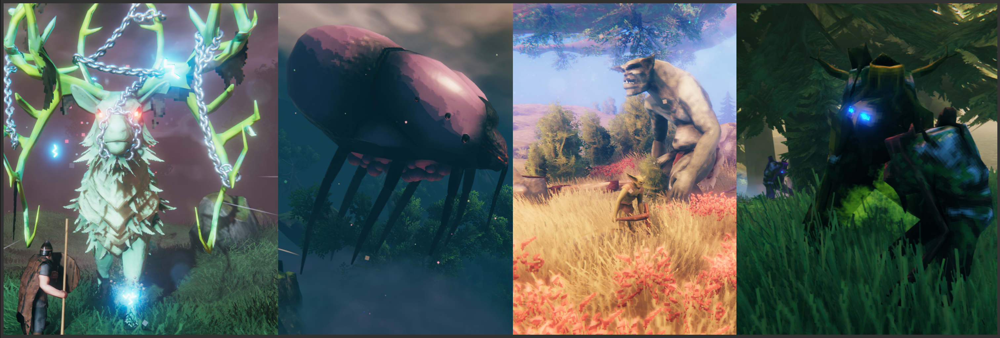

## First-time setup
First time setup is easy, install the mod and its dependencies and start the game. A short walkthrough will let you configure the mod how you want.

### Quick Configuration, Simple or Advanced
The panel's first page covers most worlds with a handful of settings:

- **Max level** - the most stars a creature or boss can have.
- **Difficulty** - Sets star chance and scaling per star.
- **Monster modifiers** - Adds new modifiers to creatures and bosses.
- **Enable progressive scaling** - Different ways to increase difficulty as you play.
- **Enable color changes** - Creatures change color with their star level.
- **Enable advanced options** - Shows all of the rest of the quick configuration options.

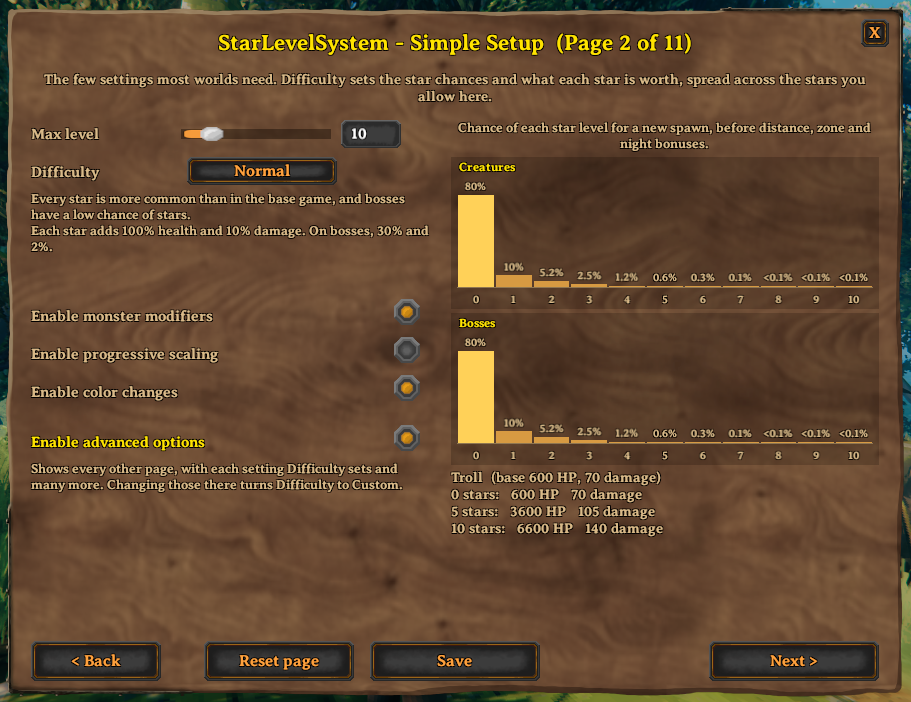

Advanced options start with the level pages. Level Distribution sets the star range and its spawn chances.

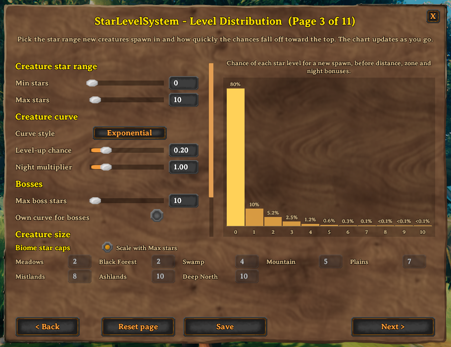

Level Scaling chooses what pushes levels up on top of that: distance, zones, regions and defeated bosses.

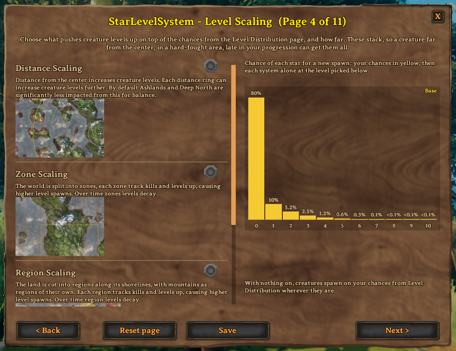

## Features
Every setting, with examples, is in the [documentation](https://github.com/MidnightsFX/Valheim_Star_Levels_Expanded/tree/master/docs). The YAML files it describes are in `BepInEx/config/StarLevelSystem/`.

### Levels
So you want creatures to have more levels, but you don't want to die instantly to a level 100 boar when you start the game? 
Well have I got the configs for you.

- [Biomes](https://github.com/MidnightsFX/Valheim_Star_Levels_Expanded/blob/master/docs/levels.md#biome-configuration) - stats, spawn rate and star cap for every creature, or for one biome.
- [Creatures](https://github.com/MidnightsFX/Valheim_Star_Levels_Expanded/blob/master/docs/levels.md#creature-configuration) - override a biome's settings for one creature, and choose modifiers it always spawns with.
- [Level chances](https://github.com/MidnightsFX/Valheim_Star_Levels_Expanded/blob/master/docs/levels.md#levelup-chance) - the chance of reaching each star, with bonuses by distance from the center.
- [Level generators](https://github.com/MidnightsFX/Valheim_Star_Levels_Expanded/blob/master/docs/levels.md#level-generators) - build those chances from a level range and a curve instead of writing a table, with a separate curve for bosses if you want one.
- [Distance, zone and region scaling](https://github.com/MidnightsFX/Valheim_Star_Levels_Expanded/blob/master/docs/levels.md#distance-zone-and-region-scaling) - raise level chances further from the center, or where the most creatures are killed. All off until you turn them on.
- [Boss-conditional chances](https://github.com/MidnightsFX/Valheim_Star_Levels_Expanded/blob/master/docs/levels.md#boss-conditional-levelup-chances) - older biomes get harder as world bosses are defeated.
- [Custom biomes and larger worlds](https://github.com/MidnightsFX/Valheim_Star_Levels_Expanded/blob/master/docs/levels.md#custom-biomes-and-larger-worlds) - biomes added by other mods work in every config file, and worlds resized by Expand World Size scale to their real size.
- [The Deep North's final boss](https://github.com/MidnightsFX/Valheim_Star_Levels_Expanded/blob/master/docs/levels.md#the-deep-norths-final-boss) - the second phase stays as vanilla made it, since it can only be hurt by the explosions of the boss spirits it calls up.

### Nemesis System
The Nemesis system is a configurable dungeon master that modifies the world around you, making things harder, easier or more interesting.

[Nemesis configuration](https://github.com/MidnightsFX/Valheim_Star_Levels_Expanded/blob/master/docs/nemesis.md)

### Colorization
Almost all creatures can be colored by their level, defined here.

[Colorization configuration](https://github.com/MidnightsFX/Valheim_Star_Levels_Expanded/blob/master/docs/colorization.md)

### Loot Configuration
Fine grained and detailed control of loot drops for creatures, objects, scenery, etc.

[Loot configuration](https://github.com/MidnightsFX/Valheim_Star_Levels_Expanded/blob/master/docs/loot.md)

### Raids
By default raids are per player and several can run at once (in different locations).

[Raid configuration](https://github.com/MidnightsFX/Valheim_Star_Levels_Expanded/blob/master/docs/raids.md)

### Boss night spawns
Defeating a boss lets new creatures roam the world at night. Configure which ones are enabled here.

[Night spawn settings](https://github.com/MidnightsFX/Valheim_Star_Levels_Expanded/blob/master/docs/night-spawns.md)

### Modifiers
Maybe you've tried out CLLC's modifiers, or Monster Modifiers? Both really add variety to the game that is much needed.
Star Levels Systems modifiers are designed to be extremely flexible, both in configuration- but also in effect.

Modifiers are split into three categories. `Boss`, `Major`, and `Minor`. Which allows customization into the random selection process for modifiers, 
along with separate tuning for modifiers that appear on bosses vs minor creatures.

What each one can be tuned with is in the [modifier configuration](https://github.com/MidnightsFX/Valheim_Star_Levels_Expanded/blob/master/docs/modifiers.md).

#### Boss Modifiers
These modifiers are by default only available on bosses.

---
| Modifier | Description | Icon |
|:---:|:---:|:---:|
| BossSummoner | Summons minion creatures at regular intervals up to a certain limit. | 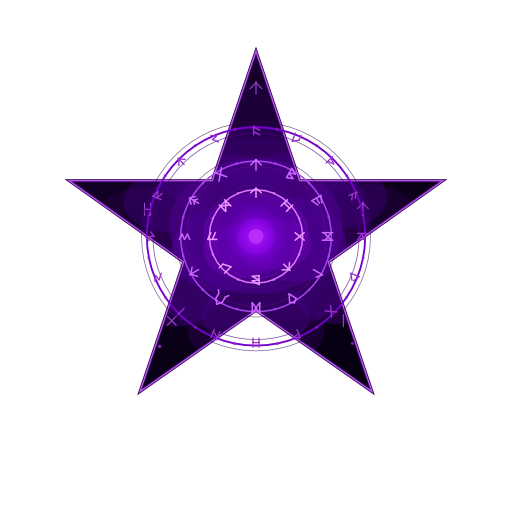 |
| SoulEater | Creature grows in strength and size when other creatures die near it. Creature heals slightly. | 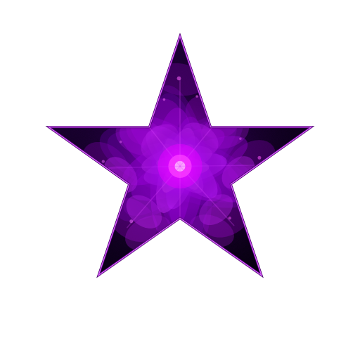 |
| LifeLink | Creature will redirect a portion of damage it takes to another creature in the area. | 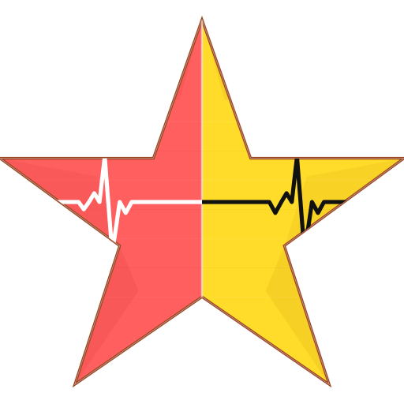 |
| ResistPierce | Reduces damage the creatures takes from all pierce sources (like arrows) | 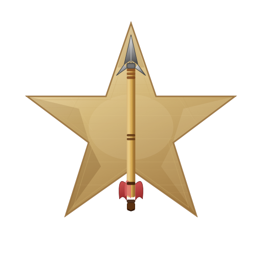 |
| Brutal | Increases creature attack speed |  |
| Stalward | Takes much less stagger damage, so it is far harder to stagger. |  |
| Shielded | Carries a shimmering shield that soaks damage before its health does, and refills when left alone. | 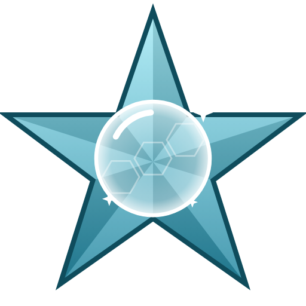 |
| EarthCaller | While fighting, calls stone spikes up under every nearby player, within seconds of the fight starting and then at random intervals; a player in the air gets one on the ground below them. The spot rumbles first, then the spike erupts, dealing blunt and pierce damage and throwing the player into the air. | 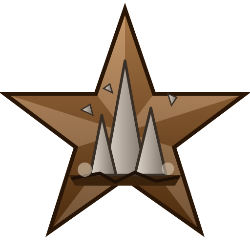 |

#### Major Modifiers
These modifiers are attainable by most creatures, and are typically the more impactful modifiers.

---
| Modifier | Description | Icon |
|:---:|:---:|:---:|
| Brutal | Increases creature attack speed |  |
| Fire | Adds Fire damage |  |
| Frost | Adds Frost Damage | 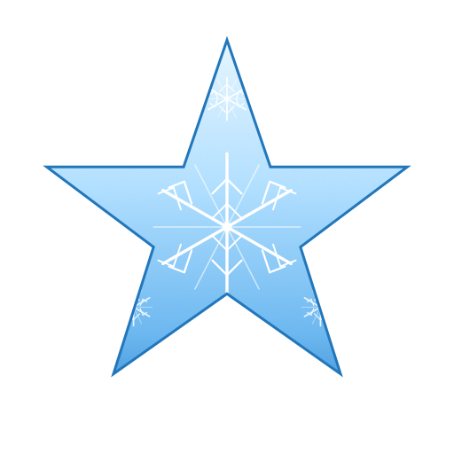 |
| Poison | Adds Poison Damage | 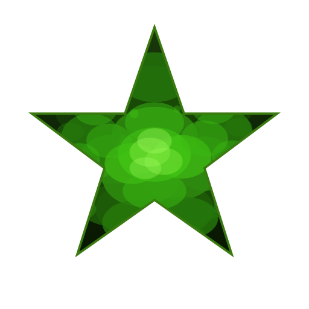 |
| Lightning | Adds Lightning damage | 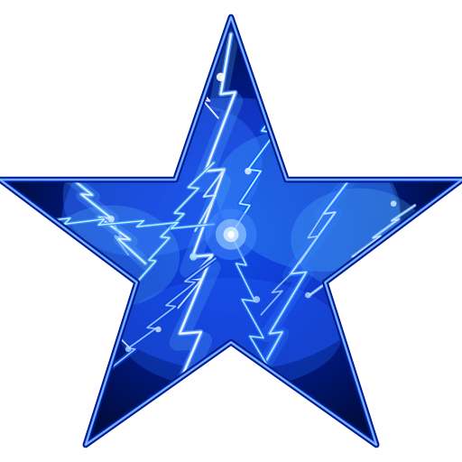 |
| Elemental Chaos | Random typed elemental damage on each hit |  |
| Splitter | Creature spawns replacements when it dies |  |
| ResistPierce | Reduces damage taken from Pierce |  |
| ResistSlash | Reduces damage taken from Slash | 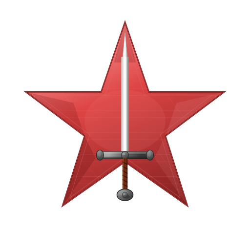 |
| ResistBlunt | Reduces damage taken from Blunt | 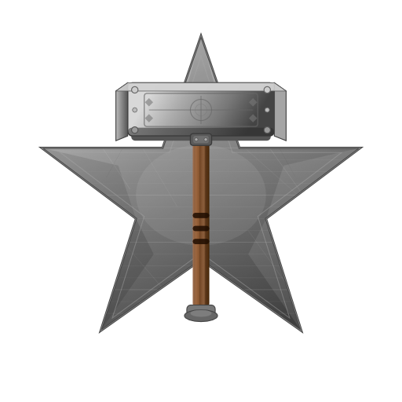 |
| Reflection | Can reflect projectiles back along their arc; shots that glance off its edge deflect elsewhere and can hit other players or creatures | 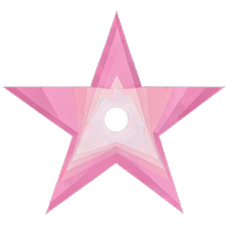 |
| Vampiric | Heals by a share of the health its hits take. | 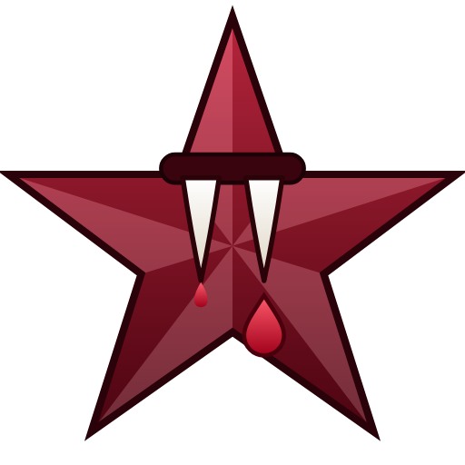 |
| Shielded | Carries a shimmering shield that soaks damage before its health does, and refills when left alone. |  |

#### Minor Modifiers
These modifiers are attainable by most creatures and are typically less directly impactful than others, but can be none the less dangerous.

---
| Modifier | Description | Icon |
|:---:|:---:|:---:|
| FireNova | Explodes when it dies, damaging everything. |  |
| PoisonNova | Explodes when it dies, damaging everything. | 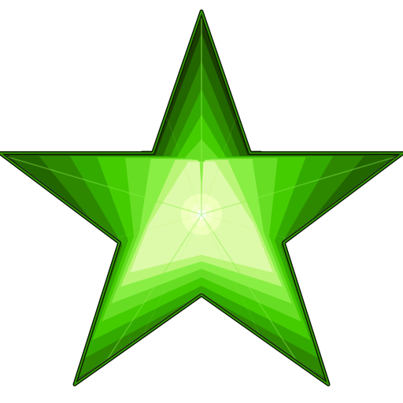 |
| FrostNova | Explodes in frost when it dies, damaging everything. |  |
| LightningNova | Explodes in lightning when it dies, damaging everything. | 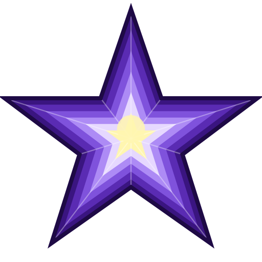 |
| Lootbags | Doubles creature health and gives 25% more movement speed, drops more loot. | 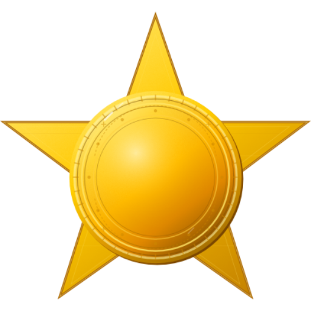 |
| Alert | Increases creature hearing range |  |
| Big | Increases creature size and health | 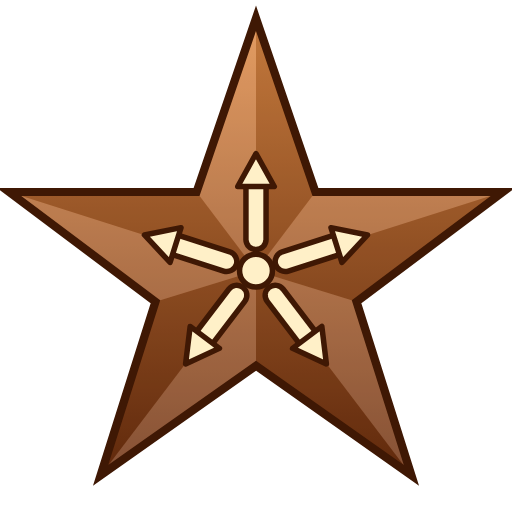 |
| Small | Shrinks the creature and weakens its attacks; each one rolls how small it is, and the smaller it is the weaker it hits. Never rolls alongside Big | 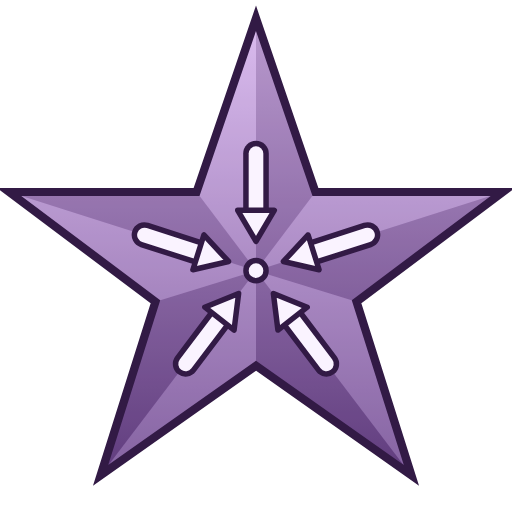 |
| Fast | Increases creature speed |  |
| Evolving | After X kills the creature gains a level. A yellow bar under its health shows how close it is to the next one, and stays full once it is at the max level |  |
| StaminaDrain | Attacks by the creature drain your stamina | 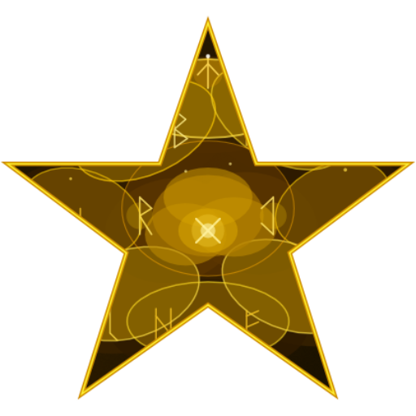 |
| EitrDrain | Attacks by the creature drain your Eitr | 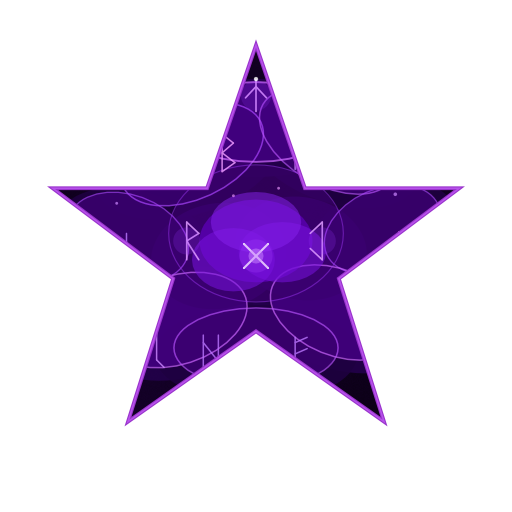 |
| ResistFire | Reduces damage taken from Fire | 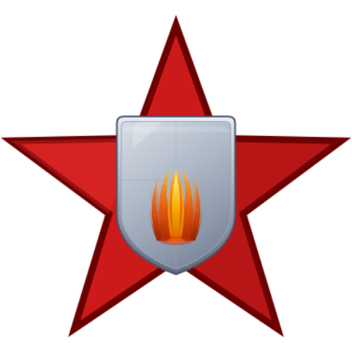 |
| ResistFrost | Reduces damage taken from Frost | 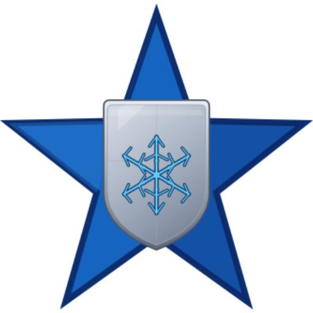 |
| ResistPoison | Reduces damage taken from Poison | 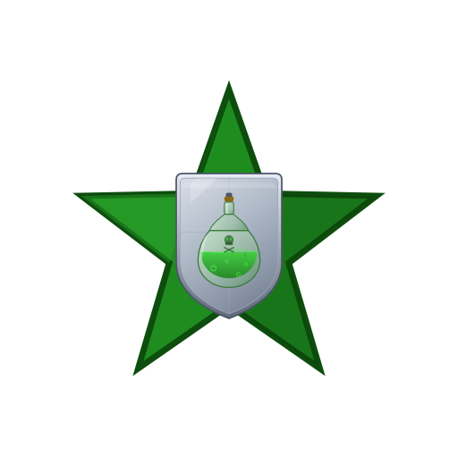 |
| ResistSpirit | Reduces damage taken from Spirit | 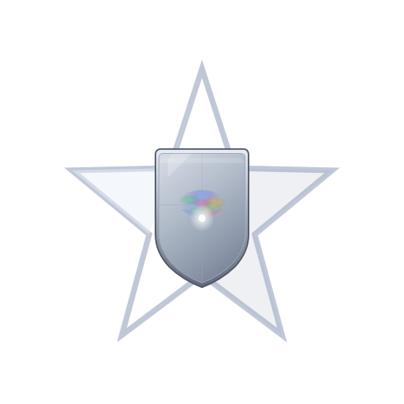 |
| Stalward | Takes much less stagger damage, so it is far harder to stagger. |  |
| Regenerating | Heals itself once it has gone a few seconds without being hit. |  |

### Location Reset

All locations, can be reset with this mod. Providing refreshed resources and fights.

[Location Reset configuration](https://github.com/MidnightsFX/Valheim_Star_Levels_Expanded/blob/master/docs/location-reset.md)

### World modifiers
SLS applies its changes ontop of existing or added world modifiers. Balance your world how you want to.

[How each one applies](https://github.com/MidnightsFX/Valheim_Star_Levels_Expanded/blob/master/docs/world-modifiers.md)

### Localization
Localization is available for everything in the mod. I accept community translations! If you would like to contribute localizations or improve them please reach out on discord.

Otherwise localizations are available at `BepInEx/config/StarLevelSystem/localizations`, new languages can be made using any of [Jotunns language specific names](https://valheim-modding.github.io/Jotunn/data/localization/language-list.html)

### Terminal Commands
Commands for debugging, testing and cleanup. Type `sls-help` in the console for the full list, or `sls-help loc` for a single group.

[Command reference](https://github.com/MidnightsFX/Valheim_Star_Levels_Expanded/blob/master/docs/terminal-commands.md)

### API Usage (WIP)
Star Level Systems provides a public API for other mods to interact with.
The API currently allows reading, modifying and managing creature stat modifiers, color, and level.
Check out the API Documentation [here](https://github.com/MidnightsFX/Valheim_Star_Levels_Expanded/tree/master/StarLevelSystem/API)

## Some of my other mods
- [Valheim Armory](https://thunderstore.io/c/valheim/p/MidnightMods/ValheimArmory/) - Fill in vanilla weapon gaps with fitting weapons
- [Impactful Skills](https://thunderstore.io/c/valheim/p/MidnightMods/ImpactfulSkills/) - Make your skills meaningful
- [Deathlink](https://thunderstore.io/c/valheim/p/MidnightMods/Deathlink/) - Death choices for all your players with progression
- [InfiniteFire](https://thunderstore.io/c/valheim/p/MidnightMods/ValheimInfiniteFire/) - Torches/Fires configurable don't require fuel
- [Valheim Fortress](https://thunderstore.io/c/valheim/p/MidnightMods/ValheimFortress/) - Build a base, defend it, reap the rewards!
- [Recipe Manager](https://thunderstore.io/c/valheim/p/MidnightMods/RecipeManager/) - Configure Recipes, build pieces, and conversions
- [Epic Jewels](https://thunderstore.io/c/valheim/p/MidnightMods/EpicJewels/) - More Jewelcrafting gem options

I also directly contribute to Epic Loot! If you like new features and bugfixes always happy to hear feedback.

## Installation (manual)
Modded Valheim requires Bepinex to load mods. If you have not modded before or are trying to simplify how easy it is for you to mod the game I recommend taking a look at a mod manager.
[Gale](https://thunderstore.io/c/valheim/p/Kesomannen/GaleModManager/) is an excellent mod manager. Download it manually, install and start it up.

If you are proceeding manually you will need to ensure that you have installed [Bepinex from the Thunderstore](https://thunderstore.io/c/valheim/p/denikson/BepInExPack_Valheim/), it has required configuration.

Once you are ready to install mods, they must be unzipped first and go into the `Bepinex/plugins` folder.

- Download and install [Yaml.net](https://thunderstore.io/c/valheim/p/ValheimModding/YamlDotNet/) and [Jotunn](https://thunderstore.io/c/valheim/p/ValheimModding/Jotunn/)
- Download this mod and install it!

## Compatibility
- This mod is incompatible with Creature Level and Loot Control (they do the same things)
- SLS Location Reset is automatically disabled if VentureValheim's LocationReset is installed, since both reset the same objects on their own timers. The rest of Star Level System works normally
- Upgrade World can be used alongside SLS, but avoid running its `locations_reset` / `vegetation_reset` commands against zones SLS Location Reset manages
- Valheim Plus works alongside SLS:
  - Its `[Pickable]` yields apply to every pickable, including ones with an SLS loot table (on drops that scale with level, alongside the world's Resources modifier)
  - Its `[Game]` difficulty scales (`gameDifficultyDamageScale`, `gameDifficultyHealthScale`) multiply onto SLS's multiplayer scaling, and apply on their own when SLS's is off. Turning on the `[Game]` section for any of its options also turns these on at their vanilla-like defaults (4% / 30% per player); set both to 0 to keep only SLS's scaling
  - Its `[Gathering]` and `[LootDrop]` multipliers apply to everything without an SLS loot table; trees, rocks, objects and creatures with their own SLS loot table drop exactly what that table says
- Project Auga lays out the enemy health bars and boss bars itself, so with Auga installed SLS only adds its stars, modifier icons, evolve bar and health numbers to Auga's bars. `EnemyHealthbarScalarX`, `EnemyHealthbarScalarY`, `StackMultipleBossHealthbars`, `BossHealthbarSpacing`, `BossHudTopBuffer` and `BossHealthbarWidthPercent` do nothing then
- Other UI mods can turn off any of SLS's enemy hud changes the same way through the API, and draw SLS's stars and evolve progress themselves (see the API documentation)

## Contributions
If you would like to donate, any amount is appreciated!
- Donators can have a name of their choice added to the Nemesis system (must be approved).

I welcome pull requests, fixes, and improvements.

## Planned Features
This mod is still in active development and is not considered complete yet.

Planned Features
- Refinement to the existing modifiers
- New modifiers!
- Generic and biome specific loot multipliers

---

If you enjoy my mods donations are appreciated. My mods will never be paid and donations are not required.

