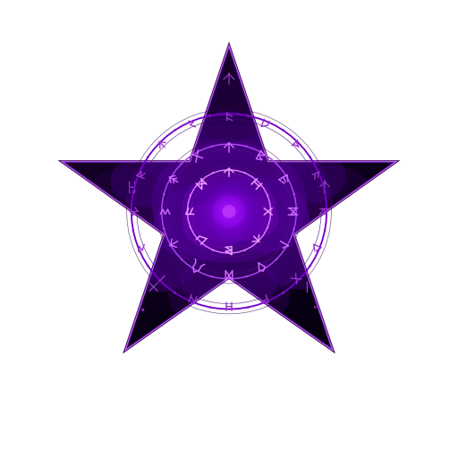
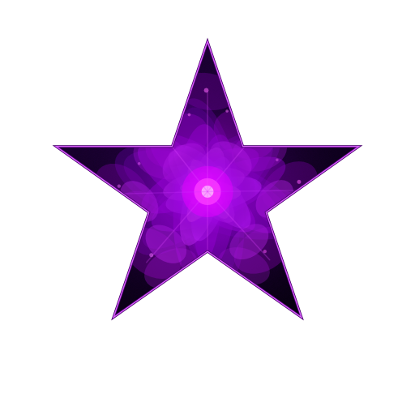
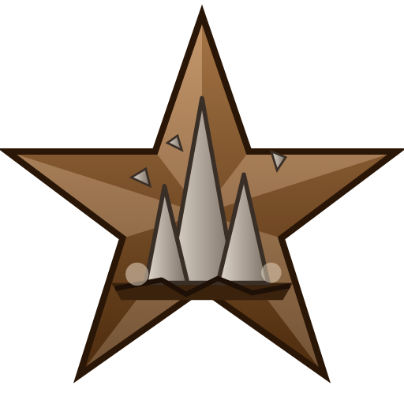
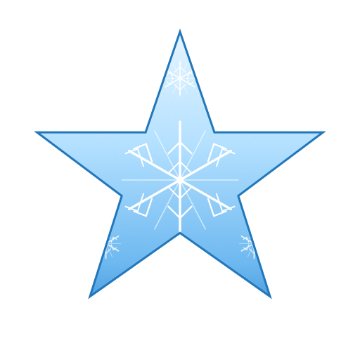
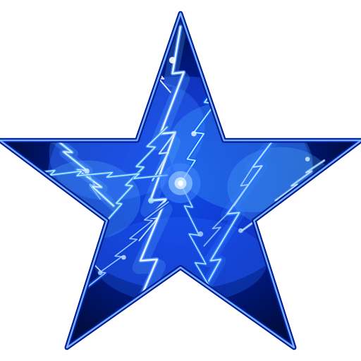
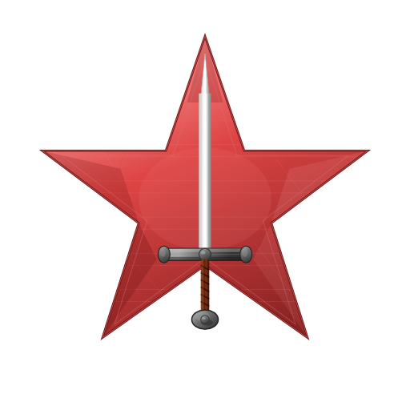
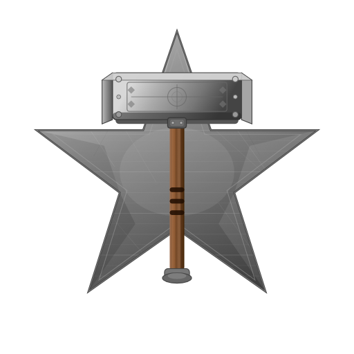
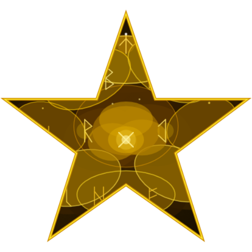
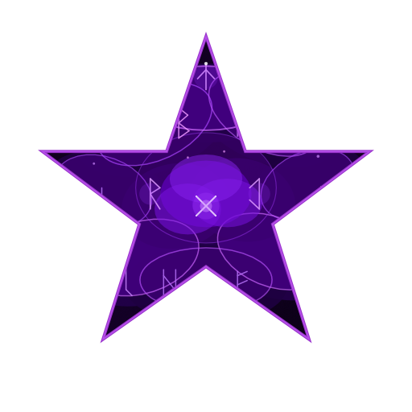

# Modifiers (Modifiers.yaml)

[All documentation](README.md)

Maybe you've tried out CLLC's modifiers, or Monster Modifiers? Both really add variety to the game that is much needed.
Star Levels Systems modifiers are designed to be extremely flexible, both in configuration- but also in effect.

There are however a number of modifiers and it can be a bit unclear what each does. So to start off here is a table of all current modifiers and how they work.

Modifiers are split into three categories. `Boss`, `Major`, and `Minor`. Which allows customization into the random selection process for modifiers, 
along with separate tuning for modifiers that appear on bosses vs minor creatures.

## Boss Modifiers
These modifiers are by default only available on bosses.

---
|   Modifier   |                                           Description                                          |                                                    Config Adjustment                                                   | Icon |
|:------------:|:----------------------------------------------------------------------------------------------:|:----------------------------------------------------------------------------------------------------------------------:|:----:|
| BossSummoner |              Summons minion creatures at regular intervals up to a certain limit.              | BasePower = Max number summoned PerlevelPower = Time between summon BiomeObjects = Biome specific minion (prefab name) Config SummonStarLimit = share (0-1) of the summoner's stars its summons may have, rounded down (default 0.5, which on a 4 star summoner allows up to 2 stars; negative = no limit) |      |
|   SoulEater  | Creature grows in strength and size when other creatures die near it. Creature heals slightly. |                                    PerlevelPower = how much health & damage to gain                                    |      |
|   LifeLink   |      Creature will redirect a portion of damage it takes to another creature in the area.      |            BasePower = Base damage redirection PerLevelPower = Additional damage redirection based on level            |      |
| ResistPierce | Reduces damage the creatures takes from all pierce sources (like arrows)                       |        BasePower = Base damage reduction PerLevelPower = Additional damage reduction granted per creature level        |      |
| Brutal       | Increases creature attack speed                                                                |      BasePower = Increases attack speed by base amount PerLevelPower = Increases attack speed by amount per level      |      |
| Stalward | Takes much less stagger damage, so it is far harder to stagger. | BasePower = share of stagger damage ignored PerLevelPower = added per level Config MaxReduction = the most it can ever ignore |      |
| Shielded | Carries a shimmering shield that soaks damage before its health does, and refills when left alone. | BasePower = shield size as a share of max health PerLevelPower = added per level Config RegenDelay = seconds without being hit before it refills Config RegenDuration = seconds an empty shield takes to fill |      |
| EarthCaller | While fighting, calls stone spikes up under every nearby player, within seconds of the fight starting and then at random intervals; a player in the air gets one on the ground below them. The spot rumbles first, then the spike erupts, dealing blunt and pierce damage and throwing the player into the air. | BasePower = spike damage as a multiple of the boss's hit PerLevelPower = added per level Config FirstCastDelay = most seconds into a fight before the first spikes Config MinInterval / MaxInterval = range of the random wait between later spikes Config Delay = seconds of rumbling before a spike Config Radius = metres the spike's hit reaches Config Range = how far from the boss players are targeted Config LaunchSpeed = how hard a spike throws players upward |      |

## Major Modifiers
These modifiers are attainable by most creatures, and are typically the more impactful modifiers.

---
|   Modifier       |                Description                |                                                                                                     Config Adjustment                                                                                                     | Icon |
|:----------------:|:-----------------------------------------:|:-------------------------------------------------------------------------------------------------------------------------------------------------------------------------------------------------------------------------:|:----:|
|    Brutal        |      Increases creature attack speed      |                                                                   BasePower = Increases attack speed PerLevelIncrease = Increases attack speed per level                                                                  |       |
|     Fire         |              Adds Fire damage             |                                                             BasePower = Percentage of total damage added PerLevelIncrease = Additional damage added per level                                                             |       |
|     Frost        |             Adds Frost Damage             |                                                             BasePower = Percentage of total damage added PerLevelIncrease = Additional damage added per level                                                             |       |
|    Poison        |             Adds Poison Damage            |                                                             BasePower = Percentage of total damage added PerLevelIncrease = Additional damage added per level                                                             |       |
|   Lightning      |           Adds Lightning damage           |                                                             BasePower = Percentage of total damage added PerLevelIncrease = Additional damage added per level                                                             |       |
| Elemental Chaos  | Random typed elemental damage on each hit |                                                             BasePower = Percentage of total damage added PerLevelIncrease = Additional damage added per level                                                             |       |
|   Splitter       | Creature spawns replacements when it dies | Config values are combined and for each whole value, an additional creature is spawned BasePower = Number of creatures to spawn on replacement PerLevelIncrease = Additional value added to give a chance for more spawns |       |
| ResistPierce     |      Reduces damage taken from Pierce     |                                                                 BasePower = base damage reduction PerLevelIncrease = per level additional damage reduction                                                                |       |
|  ResistSlash     |      Reduces damage taken from Slash      |                                                                 BasePower = base damage reduction PerLevelIncrease = per level additional damage reduction                                                                |       |
|  ResistBlunt     |      Reduces damage taken from Blunt      |                                                                 BasePower = base damage reduction PerLevelIncrease = per level additional damage reduction                                                                |       |
|   Reflection     | Can reflect projectiles back along their arc; shots that glance off its edge deflect elsewhere and can hit other players or creatures | BasePower = chance (0-1) to reflect a projectile PerLevelIncrease = additional chance per level Config ReflectedDamage = fraction of the projectile's damage the reflected shot keeps |      |
| Vampiric | Heals by a share of the health its hits take. | BasePower = share of the health taken that it heals PerLevelIncrease = added per level |      |
| Shielded | Carries a shimmering shield that soaks damage before its health does, and refills when left alone. | BasePower = shield size as a share of max health PerLevelPower = added per level Config RegenDelay = seconds without being hit before it refills Config RegenDuration = seconds an empty shield takes to fill |      |

## Minor Modifiers
These modifiers are attainable by most creatures and are typically less directly impactful than others, but can be none the less dangerous.

---
|   Modifier   |                                 Description                                 |                                                     Config Adjustment                                                     | Icon |
|:------------:|:---------------------------------------------------------------------------:|:-------------------------------------------------------------------------------------------------------------------------:|:----:|
|   FireNova   |                 Explodes when it dies, damaging everything.                 | BasePower = Base damage of the explosion, based on creature damage PerLevelPower = Increase to the damage added per level |     |
| PoisonNova   |                 Explodes when it dies, damaging everything.                 | BasePower = Base damage of the explosion, based on creature damage PerLevelPower = Increase to the damage added per level |     |
| FrostNova | Explodes in frost when it dies, damaging everything. | BasePower = Base damage of the explosion, based on creature damage PerLevelPower = Increase to the damage added per level |      |
| LightningNova | Explodes in lightning when it dies, damaging everything. | BasePower = Base damage of the explosion, based on creature damage PerLevelPower = Increase to the damage added per level |      |
|   Lootbags   | Doubles creature health and gives 25% more movement speed, drops more loot. |                      BasePower = Increases drops PerLevelPower = Increases drops by amount per level                      |     |
|     Alert    |                       Increases creature hearing range                      |                   BasePower = Increase hearing by PerLevelPower = Increase hearing by amount each level                   |      |
|      Big     |                      Increases creature size and health                     |                 BasePower = Increases health and size PerLevelPower = Increases health and size by amount                 |      |
|     Small    | Shrinks the creature and weakens its attacks; each one rolls how small it is, and the smaller it is the weaker it hits. Never rolls alongside Big | BasePower = most of its size the creature can lose PerLevelPower = added to that per level Config DamageReduction = damage lost at the full shrink Config MinimumRoll = least share (0-1) of the full effect a creature rolls |      |
|     Fast     |                           Increases creature speed                          |                    BasePower = Increases movement speed PerLevelPower = Increases speed based per level                   |      |
|   Evolving   | After X kills the creature gains a level. A yellow bar under its health shows how close it is to the next one, and stays full once it is at the max level (`EnableEvolvingProgressBar` in the UI section turns it off) | BasePower = Base number of kills required PerLevelIncrease = Additional kills required per level                          |       |
| StaminaDrain |                  Attacks by the creature drain your stamina                 |                        BasePower = Drain amount PerLevelPower = Drain increase by amount per level                        |    |
|   EitrDrain  |                   Attacks by the creature drain your Eitr                   |                        BasePower = Drain amount PerLevelPower = Drain increase by amount per level                        |    |
|  ResistFire  |      Reduces damage taken from Fire                                         |                        BasePower = base damage reduction PerLevelIncrease = per level additional damage reduction         |       |
|  ResistFrost |      Reduces damage taken from Frost                                        |                        BasePower = base damage reduction PerLevelIncrease = per level additional damage reduction         |       |
|  ResistPoison|      Reduces damage taken from Poison                                       |                        BasePower = base damage reduction PerLevelIncrease = per level additional damage reduction         |       |
|  ResistSpirit|      Reduces damage taken from Spirit                                       |                        BasePower = base damage reduction PerLevelIncrease = per level additional damage reduction         |       |
| Stalward | Takes much less stagger damage, so it is far harder to stagger. | BasePower = share of stagger damage ignored PerLevelPower = added per level Config MaxReduction = the most it can ever ignore |      |
| Regenerating | Heals itself once it has gone a few seconds without being hit. | BasePower = share of max health healed per second PerLevelPower = added per level Config OutOfCombatDelay = seconds without being hit before it heals |      |

Death novas can show a circle on the ground where they are about to burst, filling in until they do: turn on `ShowNovaIndicator` under `Client config` in the mod's .cfg. It only changes what you see.
